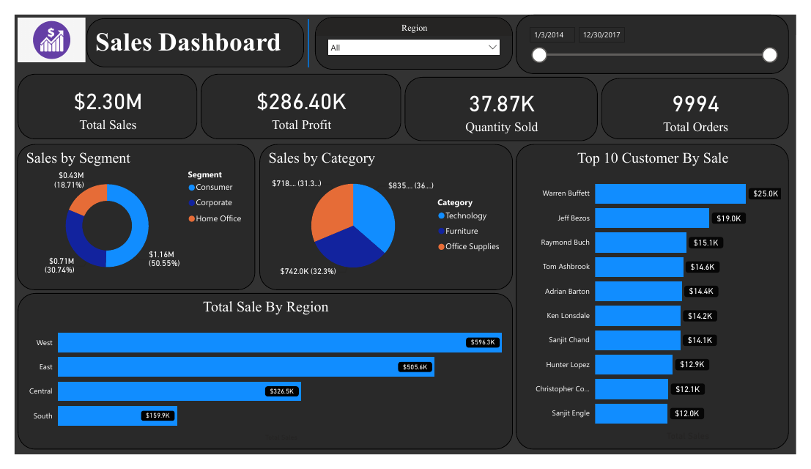

# Superstore Sales Dashboard

Sales and profit dashboard on the Superstore dataset (2014-2017): segments, categories, regions, top customers, returns and delivery.

## What it shows
- $2.30M total sales, $286K profit, 9,994 orders
- Sales by segment, category and region; top 10 customers
- Return rate, profit margin, average delivery days and discount per order

## Files
- `SuperStore Sales Dashboard.pbix`: Power BI report (open in Power BI Desktop)
- `Sales Dashboard.pdf`: exported PDF of the report
- `data/`: source data. SuperStore_Sales_Dataset.csv (included).

## Tools
Power BI, DAX, Power Query.

## Author
Asad Ullah, Data Analyst and Power BI Developer, Dammam, Saudi Arabia
[LinkedIn](https://linkedin.com/in/asadullah44) | [Portfolio](https://asadullah-the-analyst.netlify.app) | [GitHub](https://github.com/asadullah43)
